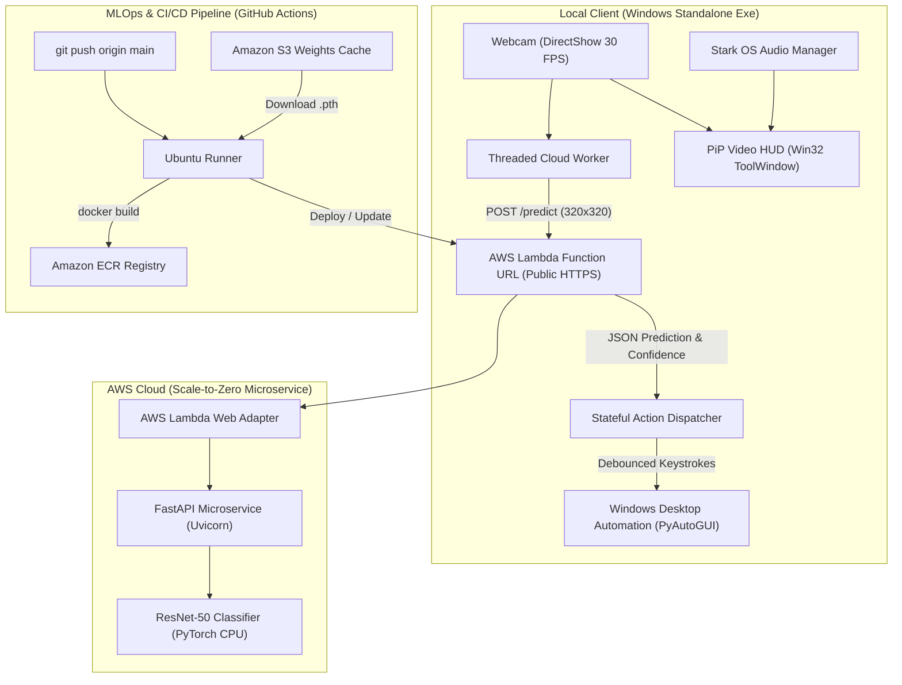

# STARK OS // IronMan Gesture-Controlled Desktop System

[](https://www.python.org/)
[](https://pytorch.org/)
[](https://fastapi.tiangolo.com/)
[](https://aws.amazon.com/lambda/)
[](https://www.docker.com/)
[](https://github.com/features/actions)

A production-grade, real-time gesture control system inspired by Tony Stark's holographic interface. Built to bridge the gap between high-FPS edge computer vision, cloud-native inference microservices, and automated MLOps infrastructure.

---

## 1. System Architecture

The project decouples edge webcam capture and desktop input automation from heavy deep-learning model execution via a scale-to-zero serverless cloud backend.



---

## 2. Recognized Gestures & OS Actions

| Gesture Class | Trained Dataset | Desktop OS Trigger | Action Description |
| :--- | :--- | :--- | :--- |
| **`mute`** | HaGRID Fine-Tuned | `Volume Mute / Unmute` | Toggles master Windows audio |
| **`take_photo`** | HaGRID Fine-Tuned | `Win + Shift + S` | Triggers Windows Snipping Tool screenshot |
| **`thumb_index2`** | HaGRID Fine-Tuned | `Win + D` | Shows / minimizes desktop workspace |
| **`heart`** | HaGRID Fine-Tuned | Custom Interface Hotkey | Stark OS HUD interface trigger |
| **`no_gesture`** | HaGRID Fine-Tuned | *None* | Passive observation mode |

---

## 3. Key Client Features

- **Floating Picture-in-Picture Tool Window**:
  - Implements `WS_EX_TOOLWINDOW` and `WS_EX_TOPMOST` via native Win32 `ctypes`.
  - Stays pinned to the top-right corner of your screen without stealing window focus and is immune to `Win + D` minimize storms.
- **Asynchronous Dual-Threaded Pipeline**:
  - The OpenCV capture and HUD render loop maintains a steady 30–60 FPS.
  - Network requests run in a background daemon thread with connection pooling and non-blocking state exchange.
- **Startup Grace Period & Volume Quieting**:
  - Gestures are disarmed during the first 2.0 seconds of bootup to prevent accidental hotkey triggers while adjusting hands.
  - Startup interface SFX are dynamically volume-scaled (30% default) for comfortable everyday use.
- **Global Emergency Killswitch**:
  - Pressing `Ctrl + Alt + Q` from **any** application immediately terminates the client without needing window focus.

### Interactive In-App Controls
| Shortcut | Function |
| :---: | :--- |
| `[A]` | Toggle OS Actions on/off (switches between active and observation mode) |
| `[P]` | Pin / Unpin Always-on-Top Picture-in-Picture mode |
| `[H]` | Toggle bottom-left shortcut hint legend |
| `[T]` | Cycle confidence threshold (`0.70` $\rightarrow$ `0.80` $\rightarrow$ `0.85` $\rightarrow$ `0.90` $\rightarrow$ `0.95`) |
| `[Q]` | Exit application |
| `[Ctrl + Alt + Q]` | **Global emergency killswitch** from anywhere in Windows |

---

## 4. Quick Start

### Option A: Standalone Windows Executable (No Python Required)
1. Download `IronManClient-v1.0-Windows.zip` from releases or build directory:
   ```text
   dist/IronManClient-v1.0-Windows.zip (75.8 MB)
   ```
2. Extract the archive anywhere on your Windows PC.
3. Double-click `IronManClient.exe` (or `START_IRONMAN.bat`).
   - *The client automatically connects to the live production AWS Lambda endpoint out of the box!*

### Option B: Run from Source (Developer Mode)
1. Clone the repository:
   ```bash
   git clone https://github.com/Nadeem-Elsayed/Iron-Man.git
   cd Iron-Man
   ```
2. Create and activate a virtual environment:
   ```bash
   python -m venv .venv
   .\.venv\Scripts\activate   # Windows PowerShell
   ```
3. Install client requirements:
   ```bash
   pip install -r local_client/requirements.txt
   ```
4. Run the client:
   ```bash
   python local_client/capture.py
   ```

---

## 5. Cloud & MLOps Infrastructure

- **Serverless Compute**: Hosted on **AWS Lambda** as an OCI Container Image using the official **AWS Lambda Web Adapter** (`awsguru/aws-lambda-adapter:0.9.0`).
- **Scale-to-Zero Cost Model**: When no client requests are arriving, active compute scales down to **zero running containers**, resulting in **$0.00/month idle cost**.
- **Automated CI/CD**: Pushing to the `main` branch triggers a GitHub Actions workflow that:
  1. Pulls model weights from secure cloud storage (Amazon S3).
  2. Compiles the optimized CPU PyTorch container.
  3. Pushes container layers to **Amazon ECR**.
  4. Automatically deploys/updates the AWS Lambda function and its public HTTPS Function URL.

---

## 6. Attributions & Media Credits

Special thanks to the artists and creators whose stock visual and sound assets brought the Stark OS interface to life:

- **Audio Sound Effects (Pixabay)**:
  - *Interface Open 1*: Created by **Vadim_Makes_Sound** on Pixabay.
  - *Interface Open 2*: Created by **SoundReality** on Pixabay.
  - *Action Sound 1*: Created by **SoundReality** on Pixabay.
  - *Action Sound 2*: Created by **juniorsoundays** on Pixabay.

- **Visual Effects & HUD Overlays (Vecteezy)**:
  - *Startup Progress Bar VFX*: Created by **Muhammad Ihsan**, [Cyberpunk Stock Videos by Vecteezy](https://www.vecteezy.com/free-videos/cyberpunk).
  - *Ambient UI Visor Overlay*: Created by **tunnelmotions loops**, [military-hud-animation-for-war-documentary Stock Videos by Vecteezy](https://www.vecteezy.com/video/76610636-military-hud-animation-for-war-documentary-showing-tactical-display-without-clear-visual-context-or-elements-during-combat-simulation).
  - *Circular Hologram HUD Reticle*: Created by **Patchakorn Phomin**, [elements-hud-circle-hologram-user-interface-technology Stock Videos by Vecteezy](https://www.vecteezy.com/video/2015841-elements-hud-circle-hologram-user-interface-technology).