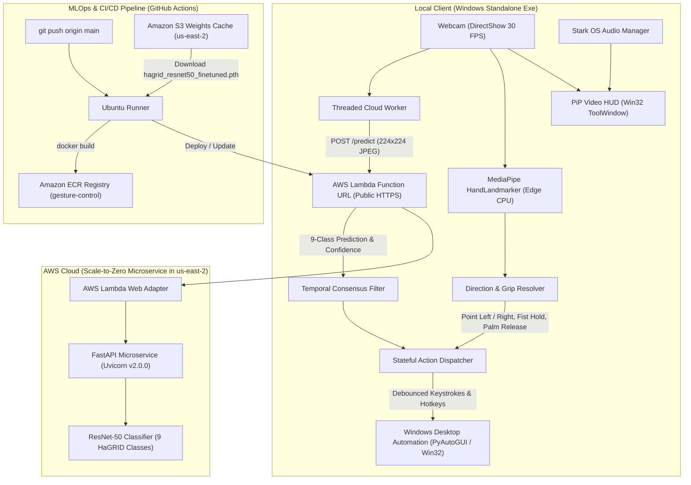

# STARK OS // IronMan Gesture-Controlled Desktop System

[](https://www.python.org/)
[](https://pytorch.org/)
[](https://developers.google.com/mediapipe)
[](https://fastapi.tiangolo.com/)
[](https://aws.amazon.com/lambda/)
[](https://www.docker.com/)
[](https://github.com/features/actions)
[](#)

A production-grade, real-time gesture control system inspired by Tony Stark's holographic interface. Features a hybrid edge-cloud architecture combining local sub-millisecond hand tracking via **MediaPipe Tasks**, a fine-tuned 9-class deep **ResNet-50** classifier, and a scale-to-zero serverless microservice running in **AWS Lambda**.

---

## 1. System Architecture

The system decouples edge webcam capture and desktop input automation from heavy deep-learning model execution via a scale-to-zero serverless cloud backend or local GPU hardware acceleration.



---

## 2. Recognized Gestures & OS Actions (Release 2.0.0)

Release 2.0.0 introduces **Modal Task-Switching (Alt-Tab)** with directional navigation and **Tab Closing (`xsign`)**, bringing total gesture support to **9 distinct classes**:

| Gesture Class | Visual Pose | Desktop OS Trigger | Action Description |
| :--- | :--- | :--- | :--- |
| **`xsign`** | Crossed forearms / wrists | `Ctrl + W` | Closes active browser tab, code editor tab, or document |
| **`grabbing`** | Closed fist / grip hold | Hold `Alt + Tab` | Opens and maintains modal Windows task switcher |
| **`point` (Right)** | Index finger pointing right | `Tab` (while holding `Alt`) | Steps forward to the next application window |
| **`point` (Left)** | Index finger pointing left | `Shift + Tab` (while holding `Alt`) | Steps backward to the previous application window |
| **`stop`** | Flat open palm | Release `Alt` / `Enter` | Selects highlighted application and dismisses task switcher |
| **`thumb_index2`** | L-shape / thumb & index | `Win + D` | Shows / minimizes desktop workspace (immune to HUD hide) |
| **`heart`** | Two hands forming heart | Launch Steam | Opens or brings the Steam client to the foreground |
| **`mute`** | Index finger over closed mouth | `Volume Mute / Unmute` | Toggles master Windows audio |
| **`take_photo`** | Camera framing / box | `Win + Shift + S` | Triggers Windows Snipping Tool screenshot |
| **`no_gesture`** | Relaxed / neutral hand | *None* | Passive observation state (no action triggered) |

> [!TIP]
> Example images with HUD banners for all 9 gestures are cataloged in [`example_gestures/`](example_gestures/).

---

## 3. Key Client Features

- **Hybrid Edge Landmark & Cloud Deep-Learning Pipeline**:
  - **MediaPipe HandLandmarker**: Sub-millisecond single-handed finger curl and pointing vector resolution directly on CPU.
  - **Fine-Tuned ResNet-50**: Evaluates complex static hand poses (`xsign`, `heart`, `thumb_index2`, `mute`, `take_photo`) with **98.11% accuracy**.
- **Temporal Consensus & Transition Suppression**:
  - Multi-frame consensus filtering (`xsign`: 2 frames, `thumb_index2`: 3 frames, `mute`: 4 frames, `grabbing`: 5 frames) eliminates accidental triggers.
  - **Global 0.90s inter-action cooldown** prevents hotkey flip-flopping when lowering or switching hands.
  - **Two-handed guard**: Modal one-handed Alt-Tab actions are suppressed whenever two hands enter the frame, preventing fist conflicts when crossing arms for `xsign`.
- **Floating Picture-in-Picture Tool Window**:
  - Implements `WS_EX_TOOLWINDOW` and `WS_EX_TOPMOST` via native Win32 `ctypes`.
  - Pinned to the top-right corner without stealing keyboard focus or disappearing when desktop is minimized.
- **Asynchronous Dual-Threaded Execution**:
  - OpenCV capture and Stark HUD maintain **30–60 FPS** smoothly.
  - Cloud inference and HTTP pooling run in a background daemon thread.
- **Global Emergency Killswitch**:
  - Pressing `Ctrl + Alt + Q` from **any** window terminates the application immediately.

### Interactive In-App Controls
| Shortcut | Function |
| :---: | :--- |
| `[A]` | Toggle OS Actions on/off (observation mode vs. active execution) |
| `[P]` | Pin / Unpin Always-on-Top Picture-in-Picture mode |
| `[H]` | Toggle bottom-left shortcut hint legend |
| `[T]` | Cycle confidence threshold (`0.70` $\rightarrow$ `0.75` $\rightarrow$ `0.80` $\rightarrow$ `0.85` $\rightarrow$ `0.90` $\rightarrow$ `0.95`) |
| `[Q]` | Exit application |
| `[Ctrl + Alt + Q]` | **Global emergency killswitch** from anywhere in Windows |

---

## 4. Quick Start

### Option A: Standalone Windows Executable (No Python Required)
1. Download `IronManClient-v2.0.0-Windows.zip` from releases or build directory:
   ```text
   dist/IronManClient-v2.0.0-Windows.zip (111.8 MB)
   ```
2. Extract the archive anywhere on your Windows PC.
3. Run `IronManClient.exe`.
   - *The client automatically connects to the production AWS Lambda v2.0.0 endpoint out of the box!*

### Option B: Run from Source (Local DirectML GPU Acceleration)
When running from source with PyTorch installed, the client automatically routes inference through your discrete GPU (AMD via DirectML or NVIDIA via CUDA) for <2 ms local execution:
1. Clone the repository:
   ```bash
   git clone https://github.com/Nadeem-Elsayed/Iron-Man.git
   cd Iron-Man
   ```
2. Activate your virtual environment and install dependencies:
   ```bash
   python -m venv .venv
   .\.venv\Scripts\activate
   pip install -r local_client/requirements.txt
   ```
3. Run the client:
   ```bash
   python local_client/capture.py
   ```

---

## 5. Cloud & MLOps Infrastructure

- **Serverless Compute**: Containerized microservice running on **AWS Lambda** in the project's selected Region (`us-east-2`) with **AWS Lambda Web Adapter** (`awsguru/aws-lambda-adapter:0.9.0`).
- **Scale-to-Zero Cost Model**: When no client frames are sent, compute scales to zero active instances ($0.00 idle cost).
- **Automated CI/CD Pipeline**:
  - Triggered on push to `main` via `.github/workflows/deploy.yml`.
  - Downloads production model weights from **Amazon S3** (`s3://ironman-models-323443471817/hagrid_resnet50_finetuned.pth`).
  - Builds the container and pushes image tags to **Amazon ECR** (`gesture-control`).
  - Updates the AWS Lambda function code and verifies readiness via the `/health` endpoint.

### Cloud Microservice Health & Endpoints
- **Health Check**: `GET /health`  
  Returns microservice status, hardware accelerator, supported gesture classes, and version.
- **Inference**: `POST /predict`  
  Accepts multipart/form-data image frame (JPEG/PNG) and returns predicted gesture, confidence score, full probability distribution, and latency.

---

## 6. Attributions & Media Credits

Special thanks to the artists and creators whose stock visual and sound assets brought the Stark OS interface to life:

- **Audio Sound Effects (Pixabay)**:
  - *Interface Open 1*: Created by **Vadim_Makes_Sound** on Pixabay.
  - *Interface Open 2*: Created by **SoundReality** on Pixabay.
  - *Action Sound 1*: Created by **SoundReality** on Pixabay.
  - *Action Sound 2*: Created by **juniorsoundays** on Pixabay.

- **Visual Effects & HUD Overlays (Vecteezy)**:
  - *Startup Progress Bar VFX*: Created by **Muhammad Ihsan**, [Cyberpunk Stock Videos by Vecteezy](https://www.vecteezy.com/free-videos/cyberpunk).
  - *Ambient UI Visor Overlay*: Created by **tunnelmotions loops**, [military-hud-animation-for-war-documentary Stock Videos by Vecteezy](https://www.vecteezy.com/video/76610636-military-hud-animation-for-war-documentary-showing-tactical-display-without-clear-visual-context-or-elements-during-combat-simulation).
  - *Circular Hologram HUD Reticle*: Created by **Patchakorn Phomin**, [elements-hud-circle-hologram-user-interface-technology Stock Videos by Vecteezy](https://www.vecteezy.com/video/2015841-elements-hud-circle-hologram-user-interface-technology).
